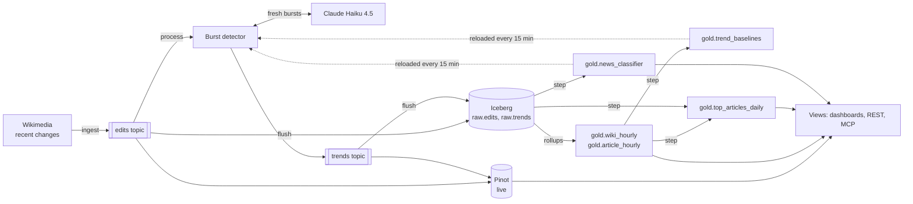

# Wiki pulse

What's happening on Wikipedia right now, in every language. A live demo of
[agentic-lakehouse](https://github.com/Jeff-VA/agentic-lakehouse), an
AI-first BI platform: streaming ingestion, a semantic layer, quality-gated
pipelines, live dashboards and AI agents over the same governed metrics.

- **Every edit to every Wikipedia article** (about 3 a second) streams from
  Wikimedia's public feed into Kafka, then Pinot (live, to the second) and
  Iceberg (all history).
- **A stream processor flags bursts**: articles getting far more edits than
  usual for their wiki and the hour, seconds after the edit that tips them over.
- **Claude Haiku 4.5 reads the freshest bursts**: news, edit war, routine or
  unclear, with one sentence saying what's happening.
- **A classifier distills Claude's judgment**: a logistic regression that a
  pipeline step retrains hourly on Claude's labels, which the detector applies
  to *every* burst in real time, including the many Claude never reads.
- **Gold tables** (hourly rollups, daily pipeline steps) are published only
  after their quality gates pass.
- **Three live dashboards**, written as plain HTML with chart tags over named
  SQL views. Agents query the same views and metrics over MCP.

## How it fits together



The loop on the right is the interesting part. The detector judges "far more
than usual" against baselines that a SQL step recomputes from a week of
rollups. It scores each burst with weights that a Python step fits on the
bursts Claude has labeled. Both steps write ordinary lakehouse tables, so the
models are versioned, quality-gated and queryable like any other data.

## The pieces

| What | Where |
| --- | --- |
| The feed's events as article edits | [`wiki_pulse/edits.py`](wiki_pulse/edits.py), `edits.source` in [`ingestion.yaml`](config/ingestion.yaml) |
| The burst detector (a stream processor) | [`wiki_pulse/trends.py`](wiki_pulse/trends.py), `trends.processor` in `ingestion.yaml` |
| Claude's read of a burst | [`wiki_pulse/explain.py`](wiki_pulse/explain.py) |
| The news classifier | [`wiki_pulse/classifier.py`](wiki_pulse/classifier.py), `news_classifier` in [`pipelines.yaml`](config/pipelines.yaml) |
| Metrics and dimensions | [`config/ontology.yaml`](config/ontology.yaml) |
| Rollups, steps and their quality gates | [`storage.yaml`](config/storage.yaml), [`pipelines.yaml`](config/pipelines.yaml), [`quality_rules.yaml`](config/quality_rules.yaml) |
| Views and dashboards | [`config/views/`](config/views/), [`config/dashboards/`](config/dashboards/) |

**Bursts.** For each article, the detector keeps its last 30 minutes of
edits. A burst needs at least 6 edits by at least 3 editors, and a count at
least 4 standard deviations above what's usual for an article being edited
on that wiki at that hour of the day. It flags a burst again only after two
hours, or sooner if the burst grows half as surprising again. After a
restart, it replays the last 30 minutes of edits to rebuild its windows,
without publishing anything twice.

**Claude.** The detector sends Claude Haiku 4.5 the article, its numbers and
its recent edit summaries, and gets back a structured label and sentence. It
asks about fresh bursts only, at most 20 an hour.

**The classifier.** It is an L2-regularized logistic regression, fit by
Newton's method in numpy. Its features are the log of edits, editors and
surprise, and the shares of edits by bots, by anonymous editors and undoing
other edits. Its quality gate requires it to beat always guessing the more
common label. The dashboard shows its agreement with Claude only on bursts it
scored *before* Claude labeled them, which makes that an honest
out-of-sample accuracy.

## Dashboards

- `/d/pulse`, **Wikipedia, live**:
  - edits, editors, new articles and reverts in the last hour;
  - edits per minute;
  - bursts as they happen;
  - the busiest wikis and articles.
- `/d/trends`, **Bursts**:
  - every burst with Claude's read;
  - the mix by kind and language;
  - the classifier: its weights, training and agreement with Claude.
- `/d/wikis`, **Wikipedias compared**:
  - hourly trends from the gold rollups;
  - revert, bot and anonymous shares side by side;
  - each day's most edited articles.

## Run it

You need Docker with about 12 GB of memory for its VM, and Python 3.11 or
later. Claude is optional. Without `ANTHROPIC_API_KEY`, bursts are still
detected and scored by the baselines, but the classifier waits for labels.

```bash
python3 -m venv .venv && .venv/bin/pip install -r requirements.txt pytest
echo "ANTHROPIC_API_KEY=sk-ant-..." > .env   # optional; never committed
docker compose -f docker/docker-compose.yml up -d --build
```

Open http://127.0.0.1:8000/d/pulse. Edits appear within seconds. The gold
tables fill as hours complete. Baselines sharpen over the first day, and the
classifier trains once Claude has labeled 30 bursts. The Prefect UI at
http://127.0.0.1:4200 shows the flush, rollup and step runs.

`pytest` runs the tests without Docker: the edit transform, the detector, the
classifier and Claude's prompt, then every view and dashboard on DuckDB
stand-ins, with the dashboards drawn in headless Chrome.

## License

Copyright (c) 2026 Jeffrey Van Anderson. All rights reserved. The code is
public to read, but no license is granted to use, copy, modify or distribute
it without permission. See [LICENSE](LICENSE).

The data comes from [Wikimedia EventStreams](https://stream.wikimedia.org/v2/stream/recentchange):
Wikipedia's content and edit metadata, under
[CC BY-SA 4.0](https://creativecommons.org/licenses/by-sa/4.0/).
